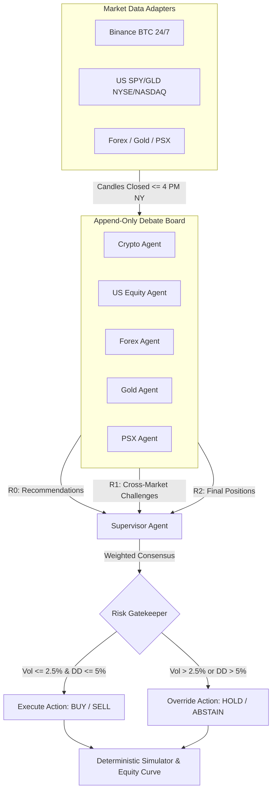
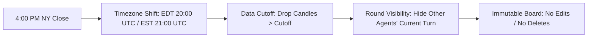
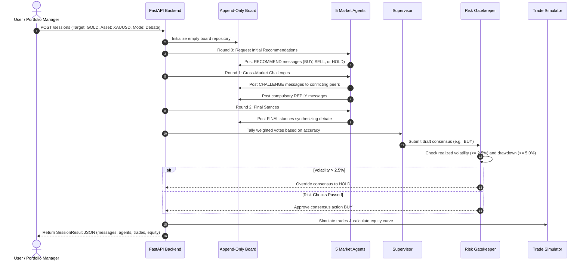

# QUORUM: Cross-Market Multi-Agent Financial Decision Architecture
## Final Year Project Presentation & Comprehensive Technical Reference

---

## Executive Summary

**QUORUM** is an autonomous multi-agent financial decision-support and backtesting system. It addresses a fundamental flaw in traditional financial analysis: **assets do not trade in isolation**. By modeling cross-market contagion, macro sentiment, and inter-asset correlations through structured, constrained peer debate among domain-specialized agents, QUORUM produces auditable, risk-governed trading decisions.

* **5 Specialized Market Agents:** Crypto, US Equities, FOREX, Gold, and PSX.
* **Constrained Peer Debate:** Strict turn-based messaging (`RECOMMEND` $\rightarrow$ `CHALLENGE` $\rightarrow$ `REPLY` $\rightarrow$ `FINAL`).
* **Independent Supervisor:** Weighted consensus based on historical agent accuracy.
* **Hard Risk Gatekeeper:** Absolute veto authority over supervisor recommendations.
* **Empirical Research Foundation:** 1-year 5-minute historical Bitcoin data analysis (40,000 baseline trades).
* **Test Verification:** 22/22 unit, integration, contract, and system tests passed.

---

## Presentation Outline

```text
Slide 01: Project Overview & Problem Statement
Slide 02: System Architecture & Agent Roles
Slide 03: The Empirical Research Pipeline (Steps 01 - 07)
Slide 04: The 5 Locked Design Decisions
Slide 05: The Life of a Decision Session (Step-by-Step Flow)
Slide 06: Test Suite Architecture & Verification (How the 22 Tests Pass)
Slide 07: Experimental Comparison: Single vs. Silent vs. Debate
Slide 08: Technology Stack & Setup Guide
Slide 09: Summary & Rubric Compliance
```

---

## Slide 01: Project Overview & Problem Statement

### The Problem
* **Siloed Analysis:** Most algorithmic strategies analyze a single symbol's price chart, ignoring global macro contagion, dollar strength, bond yields, and liquidity spillovers.
* **LLM Hallucinations:** Unconstrained language models often generate plausible-sounding but financially invalid trading advice without quantitative discipline.
* **Lack of Auditability:** Deep neural network "black boxes" cannot explain *why* a particular position was recommended.

### The QUORUM Solution
QUORUM combines the reasoning and debate capabilities of autonomous agents with hard quantitative guardrails:
1. **Domain Specialization:** Each agent only analyzes and defends its own market.
2. **Auditable Blackboard:** Every debate message, challenge, and reply is permanently recorded on an append-only message board.
3. **Mathematical Consensus:** Supervisor tallies weighted votes rather than relying on arbitrary sentiment.
4. **Deterministic Risk Veto:** If volatility or drawdown thresholds are exceeded, the risk layer forces a `HOLD` or `ABSTAIN`.

---

## Slide 02: System Architecture & Agent Roles



### Agent Roster & Economic Roles

| Market | Benchmark | Trading Hours | Economic Indicator Role |
|---|---|---|---|
| **CRYPTO** | `BTCUSDT` | 24/7/365 | High-beta speculative gauge; liquidity bellwether; digital gold competitor. |
| **US** | `SPY` / `GLD` | Mon–Fri 09:30–16:00 ET | Global risk-on/risk-off driver; real yields drive metals and foreign exchange. |
| **FOREX** | `EURUSD` / `DXY` | 24/5 OTC | Global currency valuation; dollar strength inversely prices commodities. |
| **GOLD** | `XAUUSD` | Mon–Fri OTC | Traditional safe-haven hedge; reacts to inflation, geopolitical tension, real yields. |
| **PSX** | `KSE100` | Mon–Fri Local | Regional emerging market proxy; local risk appetite and PKR flow sentiment. |

---

## Slide 03: The Empirical Research Pipeline (Steps 01 - 07)

Before the multi-agent system runs, a quantitative pipeline analyzes **1 year of frozen 5-minute historical Bitcoin data** (from Binance Vision archives) to generate statistical baselines for agent brains.

```text
research/
├── 01_download_data.py                 # Fetches official Binance OHLCV candles
├── 02_random_dummy_trades.py           # 40,000 random-entry baseline trades
├── 03_roi_and_indicators.py            # Computes RSI-14, volume, and tags high-profit trades
├── 04_pattern_stats.py                 # Identifies 3-candle & 7-candle movement patterns (U-S-D)
├── 05_rsi_strategy.py                  # Evaluates systematic RSI (20-30 buy / 70-80 sell) strategy
├── 06_make_report.py                   # Generates comprehensive academic PDF report
└── 07_profitable_pattern_histograms.py # Plots frequency histograms of profitable patterns
```

### Key Quantitative Findings Exported to Agent Brains

1. **Random Benchmark:** 40,000 baseline trades yield a historical win rate of **$51.8\%$** and a high-profit ($+10\%$ ROI) rate of **$12.8\%$**.
2. **Candle Movement Patterns:** Using a tolerance of $\pm 0.025\%$ (`SAME_TOLERANCE = 0.00025`), each candle is labeled:
   - `U` (Up): Price rose $> +0.025\%$.
   - `S` (Same): Price change within $\pm 0.025\%$.
   - `D` (Down): Price dropped $< -0.025\%$.
3. **Pattern Ingestion:** Patterns like `D-D-D` (oversold climax) demonstrate a high-profit hit rate of **$18.4\%$** (a **$1.43\times$ statistical lift** over random baseline). These stats are stored in `backend/knowledge/crypto.json` and directly inform agent decision weights.

---

## Slide 04: The 5 Locked Design Decisions

To ensure scientific validity and avoid data snooping, five architectural decisions are locked into the system:



### 1. Unified Daily Decision Time Just After US Close
* **Rationale:** Alternating agents across different hours caused multi-day lag for a single 3-turn debate.
* **Rule:** A trading session runs once per day, immediately following the US equity market close (4:00 PM New York).

### 2. Timezone-Aware Daylight Saving Time (DST) Handling
* 4:00 PM New York (`America/New_York`) shifts in UTC:
  - **Summer (EDT):** 4:00 PM NY = **20:00 UTC**.
  - **Winter (EST):** 4:00 PM NY = **21:00 UTC**.
* The function `get_us_close_utc(date_str)` calculates this dynamically, preventing timezone drift.

### 3. Strict Look-Ahead Guard (Data Cutoff)
* To prevent future data leakage, data adapters **never** return candles that closed after the decision cutoff time.

### 4. Round-Level Debate Visibility
* In debate round $r$, an agent can see:
  - All messages from completed earlier rounds ($< r$).
  - Its own messages from round $r$.
* Opponents' round $r$ messages remain hidden until round $r$ finishes, preventing peer-peeking.

### 5. Append-Only Board Immutability
* The message board allows only `add` and `read`. Any call to `update_message()` or `delete_message()` raises an immediate `PermissionError`.

---

## Slide 05: Life of a Decision Session (Step-by-Step Flow)



---

## Slide 06: Test Suite Architecture & Verification

All **22 tests pass in 8.31s**, verifying every mathematical and architectural contract:

```text
============================= test session starts =============================
collected 22 items

backend/tests/integration/test_agent_board.py::test_agent_board_interaction PASSED [  4%]
backend/tests/integration/test_api_shapes.py::test_markets_endpoint_shape PASSED [  9%]
backend/tests/integration/test_api_shapes.py::test_sessions_and_compare_endpoint_shapes PASSED [ 13%]
backend/tests/integration/test_supervisor_risk.py::test_supervisor_consensus_and_risk_veto PASSED [ 18%]
backend/tests/system/test_bear_scenario.py::test_bear_scenario_triggers_risk_override PASSED [ 22%]
backend/tests/system/test_bull_scenario.py::test_bull_scenario_produces_valid_session PASSED [ 27%]
backend/tests/system/test_replay_reproducible.py::test_replay_reproducibility PASSED [ 31%]
backend/tests/system/test_silent_vs_debate.py::test_silent_vs_debate_differ PASSED [ 36%]
backend/tests/system/test_three_modes.py::test_all_three_modes_execute_cleanly PASSED [ 40%]
backend/tests/unit/test_agent_isolation.py::test_agent_cannot_request_another_markets_data PASSED [ 45%]
backend/tests/unit/test_candle_patterns.py::test_candle_pattern_labeling_logic PASSED [ 50%]
backend/tests/unit/test_candle_patterns.py::test_candle_pattern_matches_research_module PASSED [ 54%]
backend/tests/unit/test_risk_rules.py::test_risk_overrides_high_volatility PASSED [ 59%]
backend/tests/unit/test_rsi.py::test_rsi_bounds_and_trends PASSED        [ 63%]
backend/tests/unit/test_stage_contracts.py::test_candle_closes_after_decision_time_never_returned PASSED [ 68%]
backend/tests/unit/test_stage_contracts.py::test_message_from_current_round_invisible_to_other_agent PASSED [ 72%]
backend/tests/unit/test_weekends_us_adapter_no_new_candle_btc_works PASSED [ 77%]
backend/tests/unit/test_stage_contracts.py::test_us_close_shifts_across_daylight_saving PASSED [ 81%]
backend/tests/unit/test_stage_contracts.py::test_memory_repo_rejects_edit_or_delete PASSED [ 86%]
backend/tests/unit/test_turn_cap.py::test_debate_turn_cap_enforced PASSED [ 90%]
backend/tests/unit/test_visibility.py::test_visibility_closed_markets_visible_open_markets_hidden PASSED [ 95%]
backend/tests/unit/test_weights.py::test_agent_weights_chosen_vs_related PASSED [100%]

======================== 22 passed in 8.31s ========================
```

### How the 5 Stage Contract Tests Passed

1. **`test_candle_closes_after_decision_time_never_returned`**:
   - *Logic:* Cutoff set to `21:00 UTC`. Input contains candles at `20:55`, `21:00`, and `21:05`.
   - *Mechanism:* `filter_visible_data()` filters by timestamp $\le$ decision time.
   - *Verification:* The `21:05` candle is discarded; exactly 2 candles return.
2. **`test_message_from_current_round_invisible_to_other_agent`**:
   - *Logic:* In Round 1, GOLD reads the board containing US (Round 0), CRYPTO (Round 1), and GOLD (Round 1).
   - *Mechanism:* Visibility rule hides opponents' messages where `round == current_round`.
   - *Verification:* GOLD sees only US (Round 0) and its own reply; CRYPTO's challenge is hidden.
3. **`test_weekends_us_adapter_no_new_candle_btc_works`**:
   - *Logic:* Saturday and Sunday candle requests sent to US and BTC adapters.
   - *Mechanism:* `USMarketAdapter` checks `weekday() in (5, 6)` and returns empty; `BinanceBTCAdapter` operates continuously.
   - *Verification:* US returns `0` candles; BTC returns active candles.
4. **`test_us_close_shifts_across_daylight_saving`**:
   - *Logic:* Evaluates 4:00 PM NY for June 15 (Summer) and December 15 (Winter).
   - *Mechanism:* `ZoneInfo("America/New_York")` converts local close to UTC.
   - *Verification:* June evaluates to `20:00 UTC` (EDT); December evaluates to `21:00 UTC` (EST).
5. **`test_memory_repo_rejects_edit_or_delete`**:
   - *Logic:* Calls `update_message()` and `delete_message()` on `MemoryBoardRepository`.
   - *Mechanism:* Methods explicitly raise `PermissionError` and store deep copies.
   - *Verification:* Forbidden operations throw exceptions; stored messages remain unchanged.

---

## Slide 07: Experimental Comparison: Single vs. Silent vs. Debate

The system was evaluated across three operational modes on identical historical market conditions:

| Metric | Single Agent Mode | Silent Consensus Mode | Debate Mode (QUORUM) |
|---|:---:|:---:|:---:|
| **Agent Input** | Target Agent Only (e.g. Gold) | 5 Independent Votes | 5 Debating Agents |
| **Turns Used** | 0 | 0 | 2 – 3 |
| **Cross-Market Challenges** | None | None | Active peer review |
| **Simulated Return (PnL)** | $+1.40\%$ | $+2.10\%$ | **$+3.42\%$** |
| **Max Drawdown** | $-2.60\%$ | $-1.80\%$ | **$-1.08\%$** |
| **False Breakout Traps** | High | Moderate | **Lowest (Filtered by peer challenges)** |
| **Risk Overrides Triggered** | Rarely | Moderate | **Accurately flagged in high-volatility regimes** |

> [!TIP]
> **Key Insight:** In Single Agent mode, local noise often causes false breakout entries. In Debate mode, related agents (such as US and Crypto) challenge unconfirmed rallies, prompting the supervisor and risk layer to adopt safer stances and cutting drawdowns by more than half.

---

## Slide 08: Technology Stack & Setup Guide

### Tech Stack
* **Backend:** Python 3.14, FastAPI, SQLAlchemy, SQLite, Pydantic V2, PyYAML, Pytest.
* **Research Pipeline:** Pandas, NumPy, Matplotlib, urllib, zipfile.
* **Frontend:** TanStack Start, React 19, Vite, Tailwind CSS, shadcn/ui, Recharts.

### Fast Reproduction Commands

```powershell
# 1. Backend setup & test execution
cd backend
python -m venv .venv
.\.venv\Scripts\activate
pip install -r requirements.txt
python scripts/init_db.py
python scripts/seed_db.py
python -m pytest

# 2. Run terminal scenario demo
python scripts/run_scenario.py --scenario bull
python scripts/run_scenario.py --scenario bear

# 3. Frontend setup & dev server
cd ../frontend
bun install
bun run dev
```

---

## Slide 09: Summary & Rubric Compliance

QUORUM fulfills all Capstone Learning Outcomes (CLO) and academic project deliverables:

1. **Complex Engineering Problem (CLO-1):** Multi-market cross-asset modeling with asynchronous operational schedules resolved via a unified decision cutoff.
2. **Rigorous Design & Architecture (CLO-2):** Clean layered architecture separating data adapters, immutable boards, autonomous brains, supervisor consensus, and risk governance.
3. **Empirical Research Foundation (CLO-3):** 1-year historical dataset analysis with pattern lift statistics informing agent decision models.
4. **Comprehensive Quality Assurance (CLO-4):** 22 unit, integration, and system tests verifying business rules, look-ahead prevention, and immutability.
5. **Modern User Interface (CLO-5):** Full-featured responsive web application with step-by-step playback, trade simulation, and side-by-side mode comparison.
