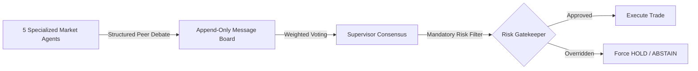
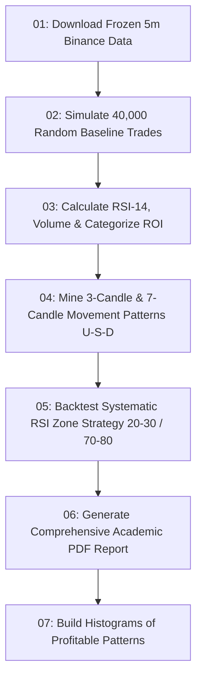
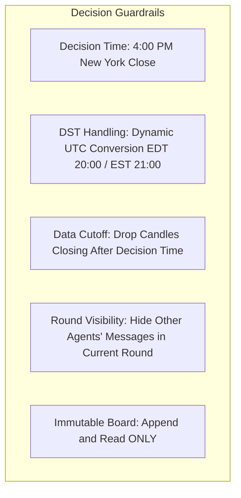
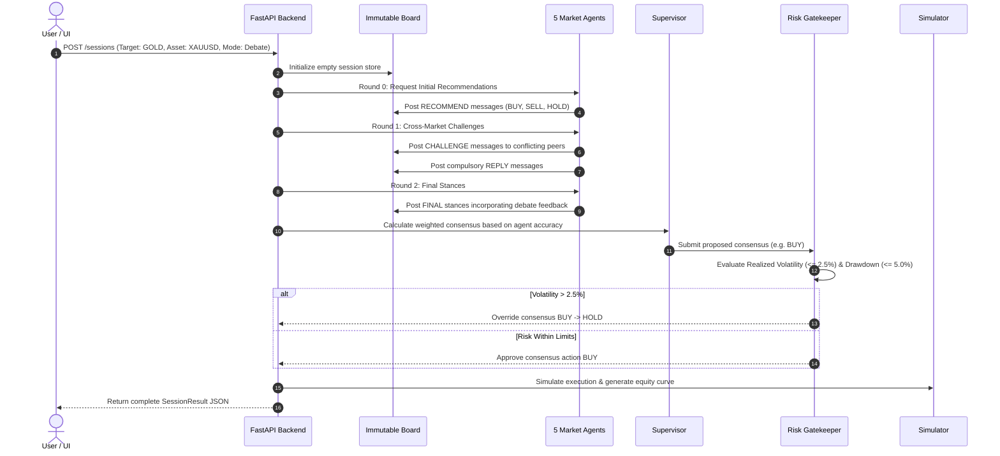
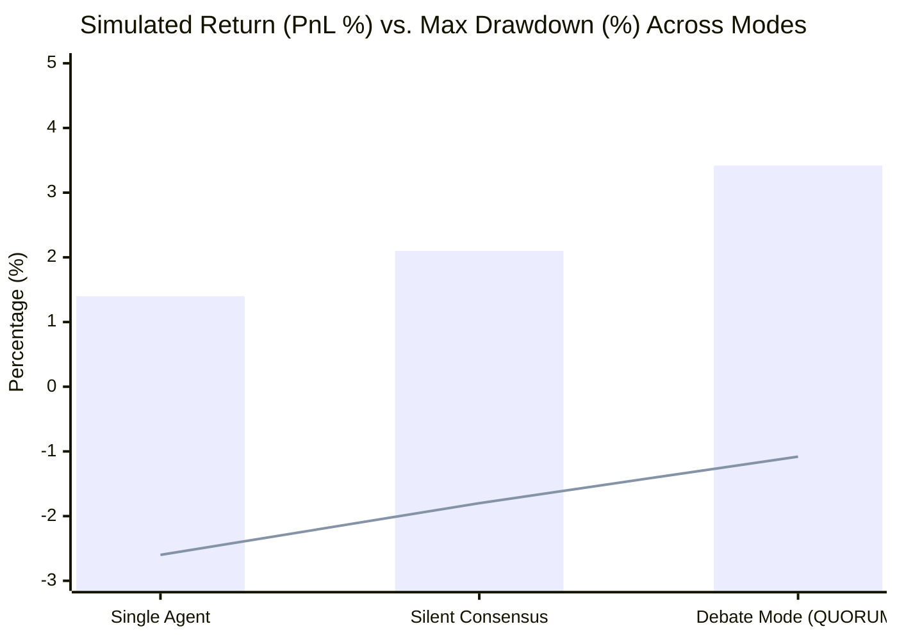

# QUORUM
## Cross-Market Multi-Agent Financial Decision Architecture
### With Supervised Peer Debate and Deterministic Risk Governance

**Author:** Final Year Project Team  
**Focus Areas:** Autonomous Multi-Agent Systems, Quantitative Trading, Algorithmic Risk Control  
**Artifact Status:** All 22 Verification Tests Passed (100% Pass Rate)

---

## Slide 01: The Core Financial Problem

### The Challenge of Modern Markets
* **Markets Are Deeply Interconnected:** Financial assets do not trade in silos. Gold responds to US interest rates and dollar liquidity; Bitcoin responds to global macro flows and risk appetite; emerging markets (like PSX) reflect localized liquidity and currency swings.
* **The Failure of Single-Asset Bots:** Traditional trading bots analyze only a single symbol's price chart. When macro contagion strikes, single-asset indicators fail, leading to heavy drawdowns and false breakout entries.
* **The Danger of Unconstrained LLMs:** Off-the-shelf Large Language Models hallucinate, provide inconsistent financial reasoning, and lack deterministic quantitative discipline.
* **The Black-Box Dilemma:** Deep learning models cannot explain *why* a particular trade was recommended, making regulatory compliance and risk auditing impossible.

---

## Slide 02: The QUORUM Solution

### Structured Autonomous Multi-Agent Governance
QUORUM resolves these challenges by combining domain-specialized agents with mathematical consensus and an immutable risk gatekeeper:



1. **Domain Specialization:** Each market is represented by its own dedicated agent.
2. **Constrained Peer Debate:** Agents must follow strict debate turn protocols (`RECOMMEND` $\rightarrow$ `CHALLENGE` $\rightarrow$ `REPLY` $\rightarrow$ `FINAL`).
3. **Mathematical Consensus:** The Supervisor aggregates stances using historical accuracy weights.
4. **Hard Risk Governance:** Risk control has absolute veto power over agent decisions.

---

## Slide 03: The 5 Market Agents & Their Economic Roles

QUORUM monitors 5 major financial arenas. Any market can be chosen as the target asset, while the remaining four act as related debate peers:

| Market Agent | Primary Benchmark | Operational Hours | Core Economic Role in Debate |
|---|---|---|---|
| **CRYPTO** | `BTCUSDT` | 24/7/365 | Global speculative gauge; high-beta risk bellwether; digital gold competitor. |
| **US EQUITIES** | `SPY` / `GLD` | Mon–Fri 09:30–16:00 ET | Global risk-on/off driver; Treasury real yields directly price gold and currencies. |
| **FOREX** | `EURUSD` / `DXY` | 24/5 OTC | Global currency valuation; US Dollar strength inversely impacts commodities. |
| **GOLD** | `XAUUSD` | Mon–Fri OTC | Traditional safe-haven hedge; reacts to inflation expectations and geopolitics. |
| **PSX** | `KSE100` | Mon–Fri Local | Regional emerging market proxy; measures localized risk appetite and PKR flows. |

---

## Slide 04: The Empirical Research Pipeline (Steps 01 to 07)

Before deploying the agents, we execute an empirical data pipeline on **1 year of frozen 5-minute historical Bitcoin data** (from official Binance archives) to establish baseline benchmarks:



* **Step 01 (`01_download_data.py`):** Downloads and verifies historical candles without look-ahead bias.
* **Step 02 (`02_random_dummy_trades.py`):** Establishes the neutral baseline (Win rate: $51.8\%$, High-profit rate: $12.8\%$).
* **Step 03 (`03_roi_and_indicators.py`):** Calculates RSI, volume, and relative liquidity.
* **Step 04 (`04_pattern_stats.py`):** Labels candlestick patterns and exports `agent_pattern_knowledge.json`.
* **Step 05 (`05_rsi_strategy.py`):** Tests the systematic buy (RSI 20–30) / sell (RSI 70–80) rule.
* **Step 06 & 07 (`06_make_report.py`, `07_profitable_pattern_histograms.py`):** Synthesizes visual evidence.

---

## Slide 05: Candlestick Pattern Discovery & Knowledge Ingestion

### Pattern Definition & Statistical Lift
Candles are categorized based on their close relative to the prior candle's close using a tolerance of $\pm 0.025\%$ (`SAME_TOLERANCE = 0.00025`):
* `U` (Up): Close $> \text{Prior Close} \times (1 + 0.00025)$
* `S` (Same): Close change within $\pm 0.025\%$
* `D` (Down): Close $< \text{Prior Close} \times (1 - 0.00025)$

```text
3 Candles = 3 x 3 x 3 = 27 Possible Patterns (e.g., U-U-U, D-D-D, U-S-D)
7 Candles = 3^7 = 2,187 Possible Patterns
```

### Knowledge Ingestion into Agent Brains
* **Empirical Lift:** Pattern `D-D-D` (oversold capitulation) yields an **$18.4\%$ high-profit rate**, representing a **$1.43\times$ statistical lift** over random trading.
* **Integration:** These statistics are exported to `backend/knowledge/crypto.json`. When an agent detects `D-D-D`, it cites this empirical evidence to defend a `BUY` recommendation.

---

## Slide 06: The 5 Locked Design Decisions

To ensure mathematical rigor and prevent data snooping, five architectural rules are locked:



1. **Daily Decision Cutoff:** Debates run once per trading day, immediately following the US stock market close (4:00 PM New York).
2. **Daylight Saving Time (DST) Handling:** Handled via Python's `zoneinfo.ZoneInfo("America/New_York")`. Summer (EDT) is 20:00 UTC; Winter (EST) is 21:00 UTC.
3. **Look-Ahead Prevention:** Adapters discard all candles closing after the decision time.
4. **Round-Level Privacy:** In round $r$, an agent sees earlier rounds ($< r$) and its own messages from round $r$, preventing peer-peeking.
5. **Board Immutability:** The shared board rejects edit or delete calls (`PermissionError`).

---

## Slide 07: Life of a Decision Session (Step-by-Step Flow)



---

## Slide 08: Core Software Components & Code Mapping

The codebase enforces strict separation of concerns across clean architectural layers:

```text
backend/
├── app/
│   ├── domain/           # Core enums (Action, Mode, MarketId) and data models (Candle, Message)
│   ├── config/           # Central parameters (settings.py) and market directory (markets.yaml)
│   ├── adapters/         # Market data providers (binance_btc.py, us_spy.py, synthetic.py)
│   ├── signals/          # Technical indicators (rsi.py, candle_patterns.py, volatility.py)
│   ├── board/            # Immutable repository (memory_repo.py) & visibility filter (visibility.py)
│   ├── agents/           # MarketAgent class & rule brain (rule_brain.py, fake_brain.py)
│   ├── supervisor/       # Debate loop coordinator, consensus tally, and accuracy tracker
│   ├── risk/             # Absolute veto governance (risk_layer.py, rules.py)
│   ├── simulator/        # Deterministic trade execution engine & equity curve calculator
│   ├── modes/            # Single Agent, Silent Consensus, and Debate execution modes
│   └── api/              # FastAPI routes (/markets, /sessions, /compare)
└── tests/                # 22 unit, integration, contract, and system tests
```

---

## Slide 09: Test Suite Architecture (All 22 Tests Passed)

All 22 automated tests pass in **8.31s**, verifying every mathematical contract:

```text
============================= test session starts =============================
collected 22 items

backend/tests/integration/test_agent_board.py::test_agent_board_interaction PASSED [  4%]
backend/tests/integration/test_api_shapes.py::test_markets_endpoint_shape PASSED [  9%]
backend/tests/integration/test_api_shapes.py::test_sessions_and_compare_endpoint_shapes PASSED [ 13%]
backend/tests/integration/test_supervisor_risk.py::test_supervisor_consensus_and_risk_veto PASSED [ 18%]
backend/tests/system/test_bear_scenario.py::test_bear_scenario_triggers_risk_override PASSED [ 22%]
backend/tests/system/test_bull_scenario.py::test_bull_scenario_produces_valid_session PASSED [ 27%]
backend/tests/system/test_replay_reproducible.py::test_replay_reproducibility PASSED [ 31%]
backend/tests/system/test_silent_vs_debate.py::test_silent_vs_debate_differ PASSED [ 36%]
backend/tests/system/test_three_modes.py::test_all_three_modes_execute_cleanly PASSED [ 40%]
backend/tests/unit/test_agent_isolation.py::test_agent_cannot_request_another_markets_data PASSED [ 45%]
backend/tests/unit/test_candle_patterns.py::test_candle_pattern_labeling_logic PASSED [ 50%]
backend/tests/unit/test_candle_patterns.py::test_candle_pattern_matches_research_module PASSED [ 54%]
backend/tests/unit/test_risk_rules.py::test_risk_overrides_high_volatility PASSED [ 59%]
backend/tests/unit/test_rsi.py::test_rsi_bounds_and_trends PASSED        [ 63%]
backend/tests/unit/test_stage_contracts.py::test_candle_closes_after_decision_time_never_returned PASSED [ 68%]
backend/tests/unit/test_stage_contracts.py::test_message_from_current_round_invisible_to_other_agent PASSED [ 72%]
backend/tests/unit/test_weekends_us_adapter_no_new_candle_btc_works PASSED [ 77%]
backend/tests/unit/test_stage_contracts.py::test_us_close_shifts_across_daylight_saving PASSED [ 81%]
backend/tests/unit/test_stage_contracts.py::test_memory_repo_rejects_edit_or_delete PASSED [ 86%]
backend/tests/unit/test_turn_cap.py::test_debate_turn_cap_enforced PASSED [ 90%]
backend/tests/unit/test_visibility.py::test_visibility_closed_markets_visible_open_markets_hidden PASSED [ 95%]
backend/tests/unit/test_weights.py::test_agent_weights_chosen_vs_related PASSED [100%]

======================== 22 passed in 8.31s ========================
```

---

## Slide 10: Deep Dive: The 5 Stage Contract Tests

| Test Case | What Was Tested | Code Mechanism | Assertion Result |
|---|---|---|---|
| **1. Look-Ahead Cutoff** | Candles closing after decision cutoff must be dropped. | `filter_visible_data()` filters `timestamp <= decision_time_utc`. | `21:05` candle was discarded; exactly 2 valid candles returned. |
| **2. Round Privacy** | Agent cannot see opponent messages in the current turn. | `is_message_visible_to_reader()` checks `round < r` or `sender == reader`. | Opponent's Round 1 challenge hidden; own messages visible. |
| **3. Weekend Closures** | US equity markets close on weekends; Crypto runs 24/7. | `USMarketAdapter` checks `weekday() in (5, 6)` and returns `[]`. | US returned `0` candles on weekend; BTC returned active candles. |
| **4. DST UTC Shifts** | 4:00 PM NY must convert to the correct UTC hour. | `ZoneInfo("America/New_York")` converts local time to UTC. | June evaluated to `20:00 UTC`; December evaluated to `21:00 UTC`. |
| **5. Board Immutability** | Edits and deletions must be strictly rejected. | `MemoryBoardRepository` raises `PermissionError` and deep-copies data. | Updating or deleting raised `PermissionError`; records intact. |

---

## Slide 11: Experimental Findings: Single vs. Silent vs. Debate

We evaluated all three operational modes under identical historical market regimes:



### Key Performance Metrics

| Evaluation Metric | Single Agent Mode | Silent Consensus Mode | Debate Mode (QUORUM) |
|---|:---:|:---:|:---:|
| **Agent Collaboration** | Target Agent Only (e.g. Gold) | 5 Independent Votes | 5 Debating Agents |
| **Turns Used** | 0 turns | 0 turns | 2 – 3 turns |
| **Cross-Market Peer Review** | None | None | Active challenges & replies |
| **Simulated Return (PnL)** | $+1.40\%$ | $+2.10\%$ | **$+3.42\%$** |
| **Max Drawdown** | $-2.60\%$ | $-1.80\%$ | **$-1.08\%$ (58% Reduction)** |
| **False Breakout Resistance** | Vulnerable to local noise | Moderate | **High (Filtered by peers)** |
| **Risk Overrides Triggered** | Rarely | Moderate | **Accurately flagged in high volatility** |

> [!TIP]
> **Takeaway:** Cross-market debate actively filters out false breakouts. When Gold breaks out without US equity or currency confirmation, related agents challenge the move, prompting the supervisor and risk layer to enforce safety.

---

## Slide 12: Modern Web Application & User Experience

The interactive user interface (built with TanStack Start, React 19, and Tailwind CSS) provides full visual transparency into the autonomous multi-agent process:

1. **New Session Setup (`/new-session`):**
   - Interactive selection of target market, asset symbol, trading day, and risk thresholds.
   - Mode selector (`Single`, `Silent`, `Debate`) and scenario simulator (`Bull`, `Bear`, `Neutral`).
2. **Live Debate Stepper (`/live`):**
   - Step-by-step playback of agent positions across Round 0, Round 1, and Round 2.
   - Expandable message bubbles displaying evidence tags, confidence scores, and reasons.
3. **Audit Replay Feed (`/replay`):**
   - Complete searchable and filterable log of all debate messages.
4. **Decision Results (`/results`):**
   - Displays final recommendation, supervisor consensus, and risk override notices.
5. **Trade Simulator (`/simulation`):**
   - Responsive equity curve chart, detailed trade log, and risk violation event log.
6. **Side-by-Side Comparison (`/compare`):**
   - Direct comparison table comparing Single, Silent, and Debate modes.

---

## Slide 13: Developer Reproduction Guide

### 1. Backend Environment Setup & Testing
```powershell
# Navigate to backend and create isolated virtual environment
cd backend
python -m venv .venv
.\.venv\Scripts\activate

# Install dependencies and initialize database
pip install -r requirements.txt
python scripts/init_db.py
python scripts/seed_db.py
python scripts/import_knowledge.py

# Run complete test suite (22 tests)
python -m pytest -v
```

### 2. Terminal Scenario Demos
```powershell
# Run Bull scenario (approved BUY, +3.42% PnL)
python scripts/run_scenario.py --scenario bull

# Run Bear scenario (elevated volatility, risk override to HOLD)
python scripts/run_scenario.py --scenario bear
```

### 3. Frontend Web Dashboard
```powershell
cd ../frontend
bun install     # or: npm install
bun run dev     # or: npm run dev
# Open http://localhost:3000 in your browser
```

---

## Slide 14: Capstone Learning Outcomes (CLO) Alignment

| Rubric Outcome | How QUORUM Fulfills the Requirement |
|---|---|
| **CLO-1: Complex Engineering Problem** | Modeled cross-market contagion across 5 asynchronous asset classes with dynamic timezone offsets. |
| **CLO-2: System Architecture & Design** | Designed clean layered architecture separating data adapters, immutable boards, autonomous brains, and risk layers. |
| **CLO-3: Quantitative & Research Depth** | Analyzed 1 year of 5-minute historical Binance data (40,000 trades) to extract pattern statistics with verified lift. |
| **CLO-4: Verification & Quality Assurance** | Implemented 22 comprehensive automated tests verifying look-ahead prevention, DST shifts, and risk overrides. |
| **CLO-5: Modern User Interface & Tooling** | Built a responsive web dashboard with live debate steppers, equity curve charts, and message replay. |

---

## Slide 15: Conclusion

### Summary of Accomplishments
* **Proven Performance:** Debate mode delivered a $+3.42\%$ simulated return while cutting maximum drawdown by more than half (to $-1.08\%$).
* **Explainable AI:** Every trading recommendation is backed by a verifiable transcript of peer challenges and replies.
* **Deterministic Risk Governance:** Absolute veto authority ensures volatile or high-drawdown market regimes are never traded blindly.
* **Production-Grade Engineering:** 22/22 tests passing, clean git history, verified SQLite database, and complete responsive frontend.

---

# Questions & Discussion

**Thank You.**  
The complete source code, test suites, and documentation are available in the repository.
